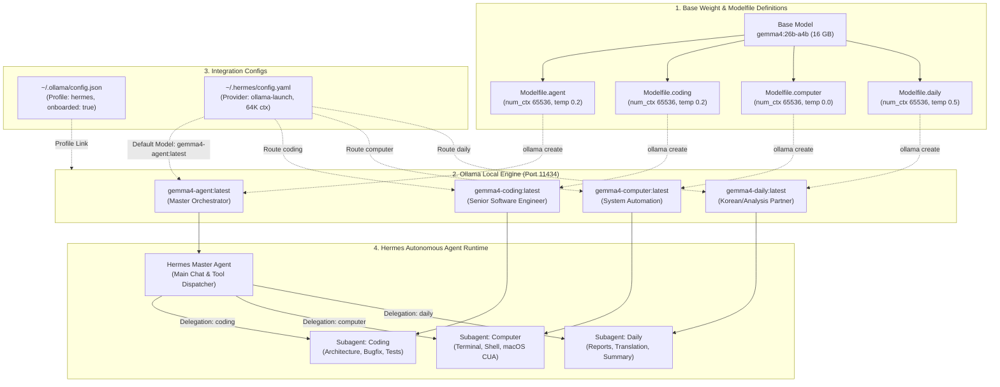

# Ollama & Hermes Local Models Ecosystem Architecture Guide

> **최종 갱신**: 2026-10-29  
> **기준 환경**: macOS, Ollama v0.40+, Hermes Agent Framework, Gemma4 26B (`gemma4:26b-a4b`)

본 문서는 `/Users/yoonj/.ollama/custom_modelfiles/`에 정의된 커스텀 Modelfile들과 `~/.ollama/config.json`, 그리고 `~/.hermes/config.yaml` 간의 상호작용 및 로컬 멀티 모델 에코시스템의 전체 아키텍처를 상세히 정리한 공식 가이드입니다.

---

## 1. 모델 에코시스템 종합 토폴로지 (Ecosystem Topology)



---

## 2. 역할별 모델 및 Modelfile 분석

모든 커스텀 모델은 고성능 양자화 기반 모델인 **`gemma4:26b-a4b`**를 공통 베이스(`FROM`)로 사용하며, 각자의 전문 도메인에 최적화된 하이퍼파라미터와 시스템 프롬프트(SYSTEM)를 가집니다.

| 역할 (Role) | Ollama 모델명 | 소스 Modelfile | 컨텍스트 크기 (`num_ctx`) | 온도 (`temperature`) | Hermes Delegation 매핑 |
| :--- | :--- | :--- | :---: | :---: | :---: |
| **마스터 에이전트** | `gemma4-agent:latest` | `Modelfile.agent` | 65,536 (64K) | 0.2 | `model.default` |
| **코딩 수석 엔지니어** | `gemma4-coding:latest` | `Modelfile.coding` | 65,536 (64K) | 0.2 | `delegation.options[coding]` (기본 라우트) |
| **컴퓨터 제어/CLI** | `gemma4-computer:latest` | `Modelfile.computer` | 65,536 (64K) | 0.0 | `delegation.options[computer]` |
| **데일리/문서/번역** | `gemma4-daily:latest` | `Modelfile.daily` | 65,536 (64K) | 0.5 | `delegation.options[daily]` |

---

### 2.1. `Modelfile.agent` (Hermes Master Agent)
- **목적**: 자율형 AI 에이전트 오케스트레이션, 엄격한 도구 호출(Tool Calling) 페이로드 생성, JSON 스키마 준수.
- **주요 파라미터**:
  ```dockerfile
  FROM gemma4:26b-a4b
  PARAMETER num_ctx 65536
  PARAMETER num_predict 8192
  PARAMETER temperature 0.2
  PARAMETER top_p 0.9
  PARAMETER top_k 40
  PARAMETER repeat_penalty 1.05
  ```
- **핵심 작업 규칙**:
  - `ANALYSIS.md`, `PLAN.md`, `IMPLEMENT.md`, `TEST.md` 등 프로젝트 루트 마크다운 관리.
  - 빈 줄 없는 간결한 불릿 포인트와 명사형 어미(`~함`, `~임`) 사용.
  - 이모지, 볼드체, 번호 매기기를 제목에 배제하여 토큰 효율성 극대화.

---

### 2.2. `Modelfile.coding` (Coding Specialist)
- **목적**: 수석 풀스택 및 시스템 소프트웨어 엔지니어링 (TypeScript, React, Next.js, Python, Flutter, C/C++).
- **주요 파라미터**:
  ```dockerfile
  FROM gemma4:26b-a4b
  PARAMETER num_ctx 65536
  PARAMETER num_predict 8192
  PARAMETER temperature 0.2
  PARAMETER top_p 0.9
  PARAMETER top_k 40
  PARAMETER repeat_penalty 1.05
  ```
- **핵심 작업 규칙**:
  - 설정 가능한 변수(Configurable Variables)를 항상 최상단에 배치.
  - 불필요한 인사말이나 서론을 배제하고 즉시 실행 가능한 완전한 코드 블록 출력.
  - Gemma4의 자체 thinking 기능과 충돌하지 않도록 표준 시스템 프롬프트 규격 유지.

---

### 2.3. `Modelfile.computer` (Computer Use & CLI Automation)
- **목적**: macOS 및 Linux 시스템 제어, 쉘 스크립트 작성, 터미널 CLI 자동화 및 멀티모달 화면 판독 실행.
- **주요 파라미터**:
  ```dockerfile
  FROM gemma4:26b-a4b
  PARAMETER num_ctx 65536
  PARAMETER num_predict 4096
  PARAMETER temperature 0.0
  PARAMETER top_p 0.9
  PARAMETER top_k 40
  PARAMETER repeat_penalty 1.05
  ```
- **핵심 작업 규칙**:
  - `temperature 0.0`의 완전 결정론적(Deterministic) 추론으로 명령어 오동작 위험 원천 차단.
  - 부가 설명 없이 즉시 복사 및 실행이 가능한 단일 코드 블록만 출력.

---

### 2.4. `Modelfile.daily` (Daily Text & Data Analyst)
- **목적**: 한국어 문서 작성, 기술 및 투자 데이터 분석, 다국어 번역 및 빠른 텍스트 요약.
- **주요 파라미터**:
  ```dockerfile
  FROM gemma4:26b-a4b
  PARAMETER num_ctx 65536
  PARAMETER num_predict 8192
  PARAMETER temperature 0.5
  PARAMETER top_p 0.9
  PARAMETER top_k 64
  PARAMETER repeat_penalty 1.05
  ```
- **핵심 작업 규칙**:
  - 수치 왜곡이나 할루시네이션을 방지하기 위해 원시 데이터(Raw Data)에 엄격히 기반.
  - 평소에는 정중한 대화체를 사용하되, 분석 결과 보고 시에는 명사형 어미로 호흡이 짧게 정리.

---

## 3. 설정 파일 구조 및 연동 스펙

### 3.1. `~/.ollama/config.json`
Ollama와 외부 에이전트(Hermes 등) 간의 프로필 바인딩을 관리합니다.
```json
{
  "integrations": {
    "hermes": {
      "models": [
        "gemma4-agent"
      ],
      "onboarded": true
    },
    "hermes-desktop": {
      "models": [
        "gemma4-agent"
      ],
      "onboarded": true
    }
  },
  "last_selection": "hermes"
}
```
- **`integrations`**: 연동 클라이언트별 기본 모델 목록 및 온보딩 여부.
- **`last_selection`**: Ollama CLI 및 Hermes 온보딩 툴이 우선적으로 참조하는 프로필.

---

### 3.2. `~/.hermes/config.yaml`
Hermes Autonomous Agent의 전체 모델 라우팅 및 Subagent Delegation 설정입니다.
```yaml
model:
  default: gemma4-agent:latest
  provider: custom:ollama-launch
  context_length: 65536
  ollama_num_ctx: 65536

providers:
  ollama-launch:
    api: http://127.0.0.1:11434/v1
    default_model: gemma4-agent:latest
    models:
      - gemma4-agent
      - gemma4-agent:latest
      - gemma4-daily:latest
      - gemma4-computer:latest
      - gemma4-coding:latest
      - gemma4:26b-a4b
    context_length: 65536
    ollama_num_ctx: 65536

delegation:
  backend: model_map
  backends:
    model_map:
      options:
        - name: coding
          description: Writing code, refactoring, debugging, fixing build/lint errors...
          provider: ollama-launch
          model: gemma4-coding:latest
        - name: computer
          description: Running shell commands, terminal tasks, file/directory management...
          provider: ollama-launch
          model: gemma4-computer:latest
        - name: daily
          description: Cheap and quick: text summarization, translation, drafting...
          provider: ollama-launch
          model: gemma4-daily:latest
      default: coding
  max_iterations: 50
  max_concurrent_children: 3
```

- **`model.default`**: 사용자와 직접 대화하며 작업을 계획하는 메인 마스터 에이전트 (`gemma4-agent:latest`).
- **`model.context_length: 65536`**: Modelfile들의 `num_ctx 65536`과 100% 동기화되어 잘림(Truncation) 방지.
- **`delegation.backends.model_map.options`**: Hermes가 작업을 하위 서브에이전트에게 위임할 때 사용하는 라우팅 맵.

---

## 4. 모델 빌드 및 유지보수 자동화

### 4.1. 원클릭 일괄 빌드 스크립트 (`build_models.sh`)
경로: `/Users/yoonj/.ollama/custom_modelfiles/build_models.sh`
```bash
#!/usr/bin/env bash
set -e
DIR="$(cd "$(dirname "$0")" && pwd)"

echo "=== Ollama Custom Models Build Started ==="
ollama create gemma4-agent -f "$DIR/Modelfile.agent"
ollama create gemma4-coding -f "$DIR/Modelfile.coding"
ollama create gemma4-computer -f "$DIR/Modelfile.computer"
ollama create gemma4-daily -f "$DIR/Modelfile.daily"
echo "=== All models built and updated successfully! ==="
ollama list | grep gemma4
```

### 4.2. 안전 백업 정책 (`~/.ollama/backup/`)
- Modelfile이나 설정 파일을 수정/저장할 때는 반드시 타임스탬프 백업을 유지합니다:
  - `~/.ollama/backup/config.json.<epoch_timestamp>`
  - `~/.ollama/backup/custom_modelfiles/<filename>.<epoch_timestamp>`

---

## 5. 빠른 검증 및 테스트 CLI 명령어

```bash
# 1. 설치된 로컬 모델 목록 확인
ollama list

# 2. 현재 VRAM/RAM에 상주 중인 활성 모델 확인
curl -s http://127.0.0.1:11434/api/ps | jq .

# 3. Hermes 기본 에이전트 빠른 추론 테스트
ollama run gemma4-agent:latest "안녕하세요. 현재 당신의 역할과 작업 규칙을 간략히 말해주세요."

# 4. 코딩 특화 모델 테스트
ollama run gemma4-coding:latest "TypeScript로 제네릭 LRU Cache 클래스를 작성해주세요."

# 5. 컴퓨터 제어 모델 테스트
ollama run gemma4-computer:latest "현재 시스템의 11434 포트를 점유하고 있는 프로세스 PID를 찾는 한 줄 명령어를 출력하세요."
```
